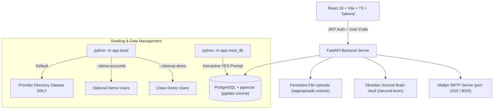

# CareBridge: Agentic Hospital Discharge & Follow-up Coordinator

> **Build to Care Code-a-Thon Submission** (Hackforge.ai x Acentra Health)  
> *A full-stack, production-grade agentic healthcare platform with PostgreSQL data persistence, database-backed consent workflows, Obsidian-style Second Brain RAG knowledge vault, interactive follow-up graphs, and automated email confirmation pipelines.*

---

## 🟢 Quick Start (One Command Launch)

To start the entire application (PostgreSQL + pgvector DB, Mailpit SMTP, FastAPI Backend, React Frontend, and auto-imported Tamil Nadu hospital directory):

```bash
docker compose up --build
```

Access Points:
- **Web Application Landing Page**: [http://localhost:3000](http://localhost:3000)
- **Patient Portal Sign-Up & Login**: [http://localhost:3000/patient/login](http://localhost:3000/patient/login)
- **Hospital Portal Sign-Up & Login**: [http://localhost:3000/hospital/login](http://localhost:3000/hospital/login)
- **My Account Profile & Password Change**: [http://localhost:3000/account](http://localhost:3000/account)
- **FastAPI OpenAPI Specs & Docs**: [http://localhost:8000/docs](http://localhost:8000/docs)
- **Mailpit Web UI (Email Inbox & Outbox)**: [http://localhost:8025](http://localhost:8025)

---

## ⚙️ Application Management, Seeding & Reset Commands

| Command | Purpose | Data Impact |
|---|---|---|
| `docker compose up -d` | Start all CareBridge services in background | Preserves all database & volume data |
| `docker compose stop` | Stop running services | Preserves all database & volume data |
| `docker compose restart` | Restart all application containers | Preserves all database & volume data |
| `docker compose down` | Stop and remove containers | **PRESERVES** named volumes (`pgdata`, `uploads_data`) |
| `docker compose down -v` | Stop containers and remove volumes | ⚠️ **DELETES ALL PERSISTENT DATA & VOLUMES** |
| `python -m app.seed` | Seed hospital directory & Second Brain | Idempotent (skips existing data, creates no fake users) |
| `python -m app.seed --demo-accounts` | Seed optional demo accounts | Creates `staff@hospital-a.demo`, `patient1@demo.com`, etc. |
| `python -m app.seed --cleanup-demo` | One-time cleanup of demo accounts | Removes fake accounts/patients; preserves provider directory |
| `python -m app.reset_db` | Interactive complete database reset | Asks `Type YES to confirm` before wiping schema |

> ⚠️ **IMPORTANT NOTE ON DATA PERSISTENCE**:  
> All operational data (users, hospitals, patients, bcrypt/argon2 password hashes, connections, follow-up charts, tasks, bookings, feedback, audit logs, vector embeddings, and uploaded document PDFs) are stored in PostgreSQL (`pgdata`) and persistent uploads (`uploads_data`).  
> **Running `docker compose down` or restarting your computer preserves all data.**  
> Only running `docker compose down -v` or `python -m app.reset_db` explicitly removes volume data.

---

## 👤 Account Registration & My Account Profile

1. **Email Normalization & Real User Check**:
   - All email addresses are trimmed and lowercased (`email.strip().lower()`) before duplicate checks and saving.
   - Duplicate checks query strictly against the real `users` table.
2. **Friendly Duplicate Email Handling**:
   - Registering an email that already exists returns an HTTP 409 Conflict with a helpful banner and two action buttons:
     - **Sign In**: Direct link to `/patient/login` or `/hospital/login`.
     - **Forgot Password**: Triggers a password reset token sent directly to the Email Outbox / Mailpit.
3. **Assigned Unique Identifiers**:
   - **Patient Sign-Up**: Creates unique Patient Code (`PAT-XXXXXX`) and dispatches a welcome email.
   - **Hospital Sign-Up**: Searchable from Tamil Nadu hospital dataset (~2,392 providers) or custom facility name, creating Hospital Code (`HOS-XXXXXX`).
4. **My Account Page (`/account`)**:
   - Accessible from the top navigation bar.
   - Displays User Code, Full Name, Email, Role, Hospital ID, and an interactive **Change Password** section.

---

## 🧪 Automated Testing

CareBridge includes a comprehensive automated test suite verifying data persistence across restarts, hospital directory preservation, duplicate email handling, and RBAC:

```bash
# Run data persistence and account registration test suite
python backend/test_persistence_and_registration.py

# Run backend RBAC, privacy masking and consent test suite
python backend/test_connections_and_rbac.py
```

All test cases pass cleanly with 100% status code and security boundary enforcement.

---

## 🏛️ System Architecture



---

## 📜 Technology Stack

- **Frontend**: React 18, Vite, TypeScript, Tailwind CSS, Recharts, Leaflet / OpenStreetMap, Lucide Icons.
- **Backend**: Python 3.12, FastAPI, SQLAlchemy, Pydantic v2, ReportLab (PDF generation), PyJWT, Passlib (argon2/bcrypt), SMTP `aiosmtplib`.
- **Database**: PostgreSQL 16 + `pgvector` extension (stored in `pgdata` Docker volume).
- **Knowledge Vault**: Linked Markdown repository (`/second-brain`) with `[[wikilinks]]` and YAML frontmatter.